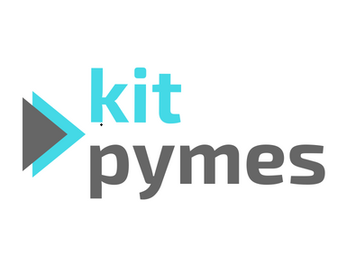
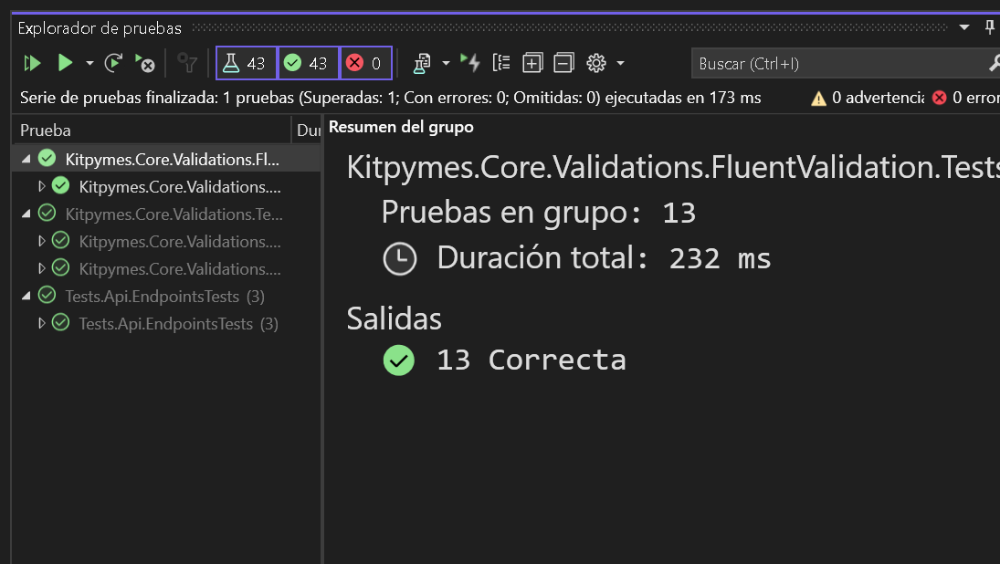

#  Kitpymes.Core.Validations

**Validaciones para multiples proveedores**

[](https://github.com/kitpymes/kitpymes-core-validations/actions/workflows/ci.yml)
[](https://www.nuget.org/packages/Kitpymes.Core.Validations/)
[](https://www.nuget.org/stats/packages/Kitpymes.Core.Validations?groupby=Version)
[](https://github.com/kitpymes/kitpymes-core-validations/blob/master/docs/LICENSE.txt)
[](https://github.com/kitpymes/kitpymes-core-validations/)
[](https://github.com/kitpymes/kitpymes-core-validations/)

## 📋 Requerimientos 

* Visual Studio 2026 o superior

* NET TargetFramework = net10.0

* SDK de .NET = 10.0.x

* C# = 12

* Conocimientos sobre Inyección de Dependencias

* Sin ASP.NET Core: desde la 3.0.0 los paquetes sólo dependen de Kitpymes.Core.Results, Kitpymes.Core.Mediator.Abstractions y las abstracciones de inyección de dependencias (el adaptador, además, de FluentValidation)

## 🔧 Instalación 

_Se puede instalar usando el administrador de paquetes Nuget o CLI dotnet._

_Nuget_

```
Install-Package Kitpymes.Core.Validations
```

_CLI dotnet_

```
dotnet add package Kitpymes.Core.Validations
```

## ⌨️ Código

### Validator&lt;T&gt;

Valida la forma de un comando, una consulta o cualquier objeto y devuelve un `Result` de Kitpymes.Core.Results: correcto, o un error de validación (`Validations.Invalido`) con un `FieldError` por cada campo que falla. Las reglas de negocio (duplicados, saldos) no van aquí, sino en el dominio o en el manejador.

```cs
public sealed class CreateOrderValidator : Validator<CreateOrder>
{
    public CreateOrderValidator()
    {
        RuleFor(x => x.Customer).Required().MaxLength(100);
        RuleFor(x => x.Email).Required().Email();
        RuleFor(x => x.Address).SetValidator(new AddressValidator());
        RuleForEach(x => x.Lines).SetValidator(new LineValidator());
        RuleFor(x => x.To).Must((order, to) => to > order.From).WithErrorCode("Pedidos.FechasCruzadas");
        RuleFor(x => x.Vat).Required().When(x => x.IsCompany);
    }
}

Result result = await new CreateOrderValidator().ValidateAsync(command, cancellationToken);
// result.Error.Fields: { Field = "lines.0.quantity", Code = "Validations.Mayor", Message = "El campo 'lines.0.quantity' debe ser mayor que 0." }
```

- El campo va con la ruta de un formulario de Angular: camelCase (respeta `[JsonPropertyName]`), con puntos y con el índice en las colecciones.
- Por defecto se para en el primer error de cada campo (`ContinueOnError()` para seguir). Salvo `Required`, `Must`, `Custom`, `Equal` y `NotEqual`, las reglas no se evalúan con un valor nulo.
- Los códigos están en `ValidationErrorCodes`. Los propios (`WithErrorCode`, `Custom`) tienen la forma `Modulo.Motivo` y no pueden usar el prefijo `Validations.`.
- Mensajes en español, o en inglés si la cultura es `en`.

### Paso del mediador

```cs
services.LoadValidations(o => o.WithAssemblies(typeof(CreateOrderValidator).Assembly));
```

Registra los validadores (singleton), un paso general que valida cada comando y consulta antes del manejador y devuelve el error sin llamarlo, y la comprobación de arranque de Kitpymes.Core.Mediator: la aplicación no arranca si un comando o consulta con datos de entrada no tiene validador, si tiene más de uno o si un validador está mal configurado.

### Adaptador de FluentValidation

```cs
services.LoadFluentValidationAdapters(typeof(CustomerValidator).Assembly);
services.LoadValidations(o => o.WithAssemblies(typeof(CustomerValidator).Assembly));
```

Expone cada `AbstractValidator<T>` como `IValidator<T>`, con las mismas rutas (`Items[0].Name` pasa a `items.0.name`) y los mismos códigos (`NotEmpty` da `Validations.Requerido`).

### Migrar desde la 2.x

La API antigua (`Validator.AddRule`, `ValidationsException`, el middleware y las extensiones de FluentValidation) se quitó en la 3.0.0. La guía punto por punto, con la tabla de equivalencias de reglas, está en las [notas de la versión](https://github.com/kitpymes/kitpymes-core-validations/blob/master/docs/RELEASE_NOTES.txt). Ojo: en la 2.x `IsGreater(10)` fallaba si el valor era mayor que 10; ahora el nombre dice lo válido (`LessThanOrEqual(10)`).

## ⚙️ Pruebas Unitarias

_Cada proyecto tiene su test que se ejecutan desde el "Explorador de pruebas"_




## 🛠️ Construido con 

* [NET Core](https://dotnet.microsoft.com/download) - Framework de trabajo
* [C#](https://docs.microsoft.com/es-es/dotnet/csharp/) - Lenguaje de programación
* [Inserción de dependencias](https://docs.microsoft.com/es-es/aspnet/core/fundamentals/dependency-injection?view=aspnetcore-3.0) - Patrón de diseño de software
* [MSTest](https://docs.microsoft.com/es-es/dotnet/core/testing/unit-testing-with-mstest) - Pruebas unitarias
* [Nuget](https://www.nuget.org/) - Manejador de dependencias
* [Visual Studio](https://visualstudio.microsoft.com/) - Entorno de programacion
* [FluentValidation](https://fluentvalidation.net/) - Proveedor de validaciones


## ✒️ Autores 

* **Sebastian R Ferrari** - *Trabajo Inicial* - [kitpymes](https://kitpymes.com)


## 📄 Licencia 

* Este proyecto está bajo la Licencia [LICENSE](LICENSE.txt)


## 🎁 Gratitud 

* Este proyecto fue diseñado para compartir, creemos que es la mejor forma de ayudar 📢
* Cada persona que contribuya sera invitada a tomar una 🍺 
* Gracias a todos! 🤓

---
[Kitpymes](https://github.com/kitpymes) 😊